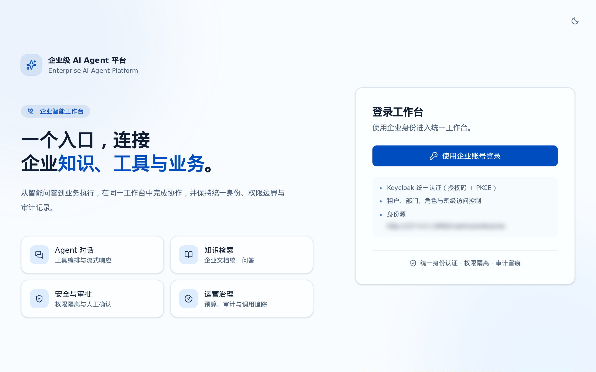
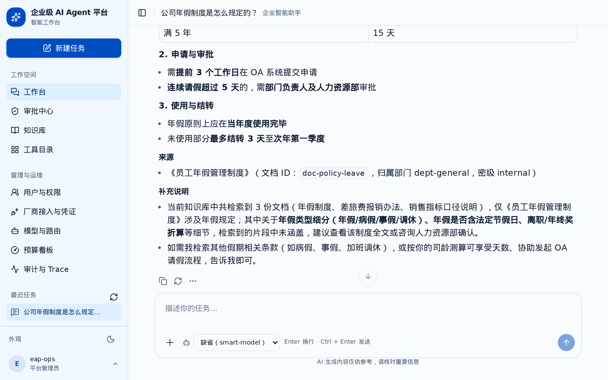
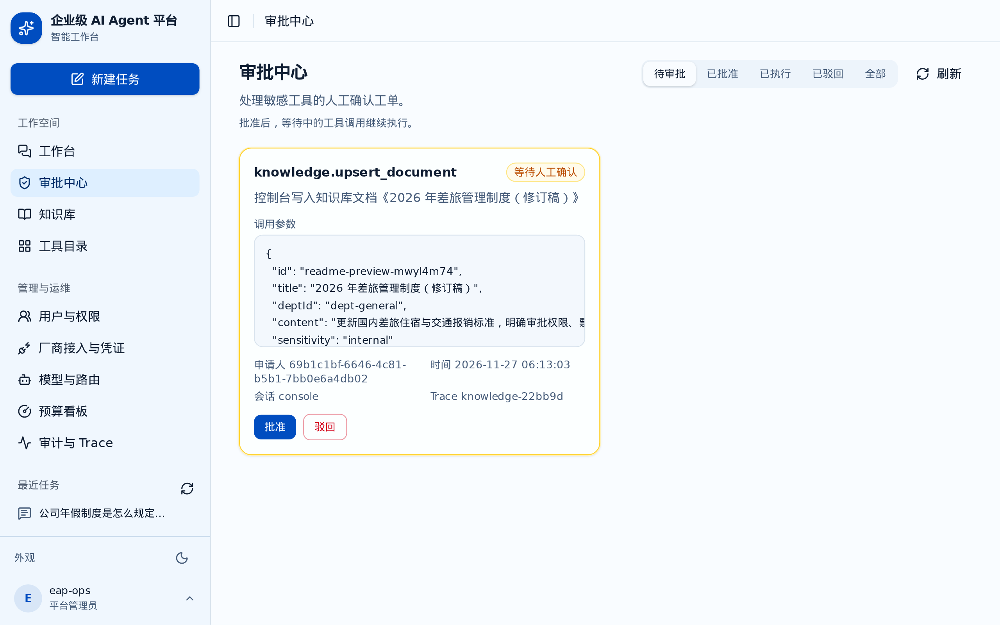
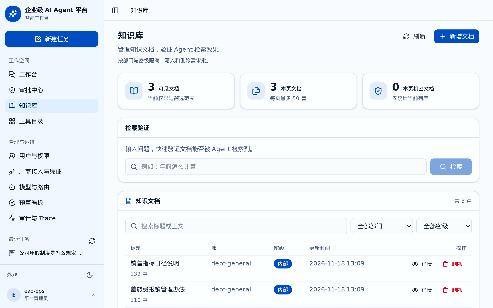
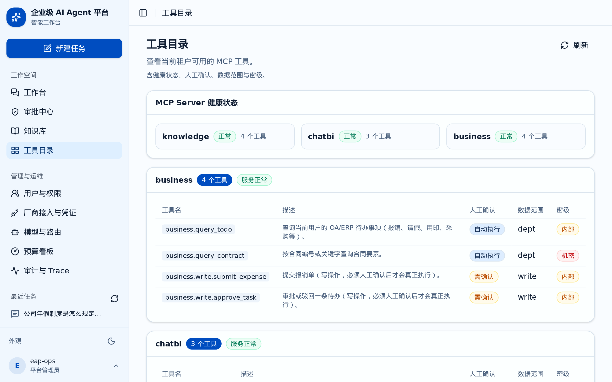
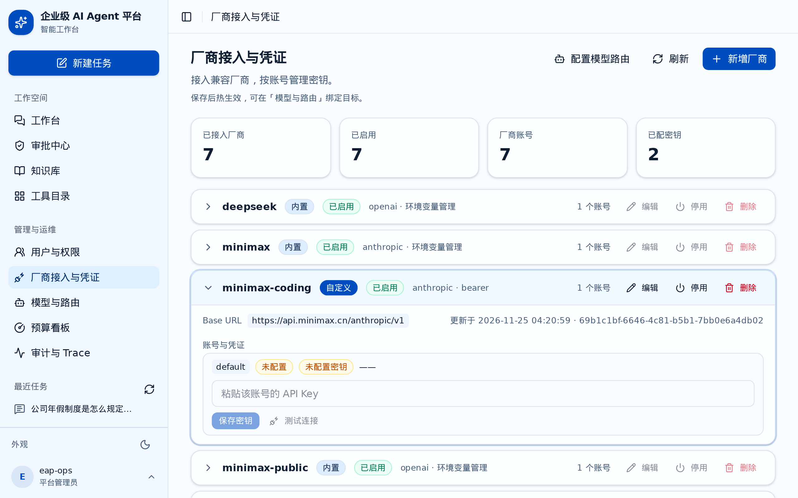
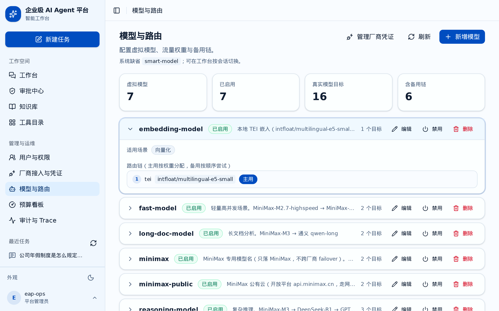
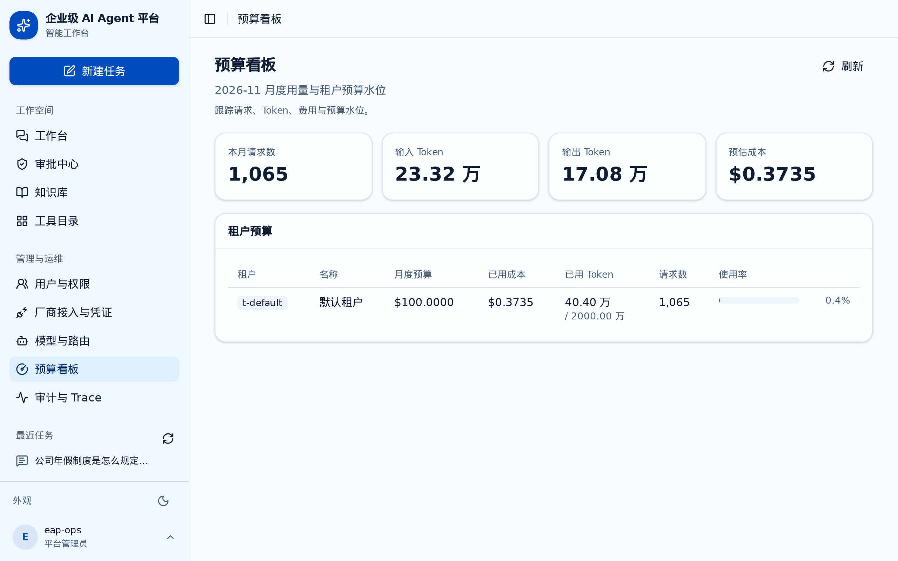
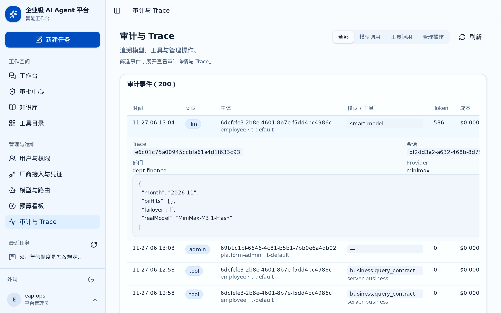
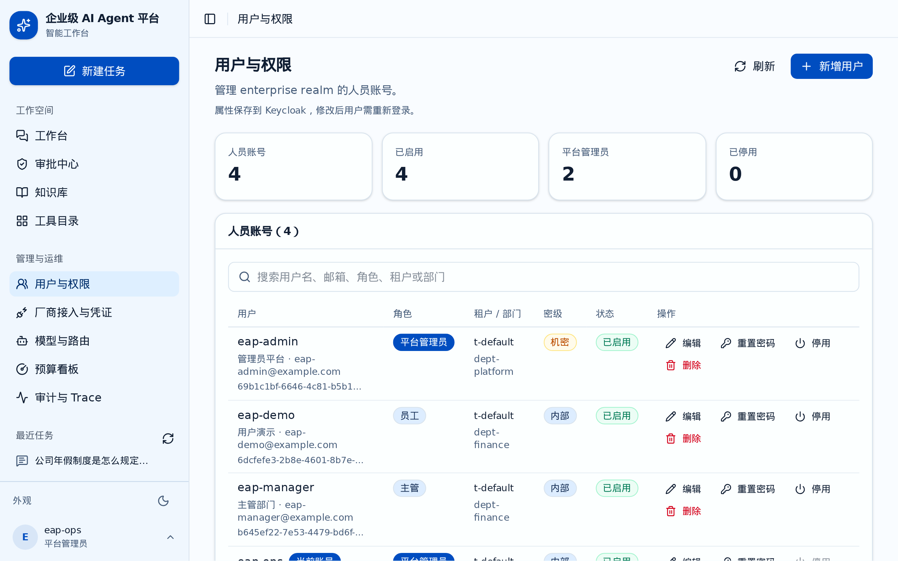

# 企业级 AI Agent 平台

> 基于[《企业级 AI Agent 平台建设方案》](./企业级%20AI%20Agent%20平台建设方案.pdf)实现的可运行参考项目。

统一网关收口商业模型与 MCP 工具调用，统一控制台承载对话、知识检索、ChatBI、审批和运维管理。项目支持 MiniMax、OpenAI、Qwen、DeepSeek、Zhipu 等模型 Provider，并集成 Keycloak、Infinity、TEI、RAGFlow、DB-GPT、Langfuse、Envoy 等组件。

本仓库同时包含**自研平台代码、真实第三方组件编排和演示数据**。它不是已经完成生产验收的企业成品；具体实现边界见[当前限制](#当前限制与生产待办)。

## 实现口径

- Agent 内核和控制台为自研实现，不是官方 AgentScope Core/Service/Web UI 的直接部署。
- Keycloak、Infinity、TEI、RAGFlow、DB-GPT、Langfuse、Envoy、Harbor 等真实组件已完成本机容器化验证，详见[组件映射与实测记录](docs/component-mapping.md)。
- Agent 实际检索平台知识库；RAGFlow 已独立验证，但其数据尚未接入平台检索链路。
- 业务 MCP 使用模拟 OA/ERP 数据；HITL 审批链真实可运行，但业务写入仍是演示实现。
- 当前完整实测路径是“Compose 依赖组件 + 宿主平台服务”；纯 Compose 编排与 Helm 是部署基线，Helm 不能等同于生产 Kubernetes 已验收。

## 方案引用

设计依据来自仓库内的[建设方案 PDF](./企业级%20AI%20Agent%20平台建设方案.pdf)，主要章节与实现对应如下：

| PDF 章节 | 方案内容 | 本仓库对应实现 |
|---|---|---|
| 2.2 总体设计原则 | 单网关、单身份源、单前端、单观测点、数据分级 | `packages/gateway`、`packages/auth-middleware`、`apps/webui` |
| 3.1 技术选型与组件清单 | Agent、RAG、ChatBI、网关、身份、存储、安全、观测 | [组件逐项映射](docs/component-mapping.md) |
| 4.1 Agent 内核 | ReAct、Toolkit、Middleware、HITL | `packages/agent-core` |
| 4.2、5.2 知识库与权限过滤 | Infinity 混合检索、TEI、本地嵌入、召回前过滤 | `packages/mcp-hub/src/retrieval`、`servers/knowledge.ts` |
| 4.3 统一网关 | 虚拟模型、Failover、三级预算、MCP Federation、Guardrails | `packages/gateway/src/llm`、`mcp`、`policy`、`guardrails` |
| 6 数据自助分析 | DB-GPT MCP、Text2SQL、只读沙箱、图表、指标口径 | `deploy/compose/dbgpt`、`packages/mcp-hub/src/servers/chatbi.ts` |
| 7、8 身份与安全 | OIDC、多租户上下文、审计、脱敏、出网白名单 | `packages/auth-middleware`、`docs/security.md` |
| 9 部署方案 | Compose POC、Kubernetes/Helm、硬件与副本规划 | `deploy/compose`、`deploy/helm` |
| 10、11 验收与运维 | 准确率/性能验收、监控、成本、备份与恢复 | `tests`、`scripts`、`docs/operations.md`；未完成的量化验收见下文 |

## 框架与技术选型

| 层次 | 选型 | 选型说明与实现边界 | 方案依据 |
|---|---|---|---|
| Agent 运行时 | 自研 TypeScript ReAct + Toolkit + Middleware | 保留企业治理和跨用户 HITL；Middleware 为 3-hook 线性子集，并非官方 Python 版 7-hook 洋葱模型 | PDF 3.1、4.1 |
| Web 控制台 | React 19、Vite 6、assistant-ui、AG-UI | 单一业务入口；任务式工作台使用标准 AG-UI 事件流，管理页面复用同一身份与网关 API | PDF 2.2、3.1 |
| 模型与工具网关 | 自研 Express agentgateway | OpenAI 兼容接口、虚拟模型、Failover、预算、工具白名单、CEL 策略、护栏和审计统一收口 | PDF 4.3 |
| 身份 | Keycloak 26、OIDC 授权码 + PKCE、JWKS | 平台控制台和业务 API 统一身份；RAGFlow 已接入 Keycloak 单点登录（首次登录自动建号），其余第三方组件管理界面保留各自管理账号 | PDF 3.1、7.1 |
| 知识检索 | 平台知识库 + Infinity 0.7.5 + TEI | BM25 与向量双路召回、RRF 融合、租户/部门/密级条件下推；TEI 当前模型为 `intfloat/multilingual-e5-small`，384 维 | PDF 4.2、5.2 |
| 文档解析 | RAGFlow 0.22.1 | 用于独立文档解析与切分验证；已接入 Keycloak 单点登录，账号口径与平台一致；当前不与平台知识库自动同步 | PDF 3.1、4.2 |
| ChatBI | DB-GPT 0.8.3 + 自研 FastMCP 适配器 | DB-GPT 上游没有 MCP Server 形态，适配器属于平台侧集成；保留本地 ChatBI 工具作为降级实现 | PDF 3.1、6.1 |
| 业务系统接入 | 自研业务 MCP + HITL | 当前为模拟 OA/ERP 数据和写入；真实系统需补充 OAuth、连接器和持久化实现 | PDF 5.1、6.3 |
| 数据与缓存 | 开发态 SQLite/Memory/FS；完整栈 PostgreSQL 16、Redis 7、MinIO | 通过统一存储接口切换；生产多副本需要外部数据库和共享状态 | PDF 3.1、9.4 |
| 观测与安全出口 | OpenTelemetry、Langfuse 3、ClickHouse、Envoy | Trace/成本归因、SNI 白名单、强制代理与审计；不引入独立 Prometheus 栈 | PDF 3.1、8.3、11.1 |
| 部署 | Docker Compose、Helm | Compose 承载本机实测依赖，平台服务运行在宿主机；纯 Compose 与 Helm 均为部署基线，重型组件集群部署仍待验证 | PDF 9.2 |

前端设计系统参考 [Ken-LK/agentscope-agui-scaffold](https://github.com/Ken-LK/agentscope-agui-scaffold)（Apache-2.0）并做了本地改造。与官方 AgentScope 的详细差异和替换成本见[对照报告](docs/agentscope-comparison.md)。

## 核心能力

- **用户与权限管理**：平台管理员可在控制台查看、新建、编辑、启停、重置密码和删除 Keycloak 人员账号；身份以 Keycloak 实时数据为准，支持自身与最后管理员保护、一次性随机密码、会话注销和脱敏审计。
- **模型与路由管理**：独立控制台页面新增、编辑、启停和删除虚拟模型，配置真实模型、主备顺序、主用权重、账号与输出上限；默认模型有明确标识和误删保护，配置持久化并对后续请求立即生效，变更全审计。管理员可在工作台按会话动态切换对话模型，未选择时跟随服务端缺省模型。
- **厂商接入与凭证管理**：页面直接新增 OpenAI / Anthropic 兼容厂商，配置 BASE_URL、认证方式和账号池；密钥按账号加密落库、掩码展示，支持连接测试、启停和引用保护，变更全审计且无需重启网关。
- **调用治理**：Provider 鉴权隔离、主用加权分流、顺序 Failover、平台/租户/应用预算与限流。
- **Agent 对话**：ReAct 工具编排、历史窗口、流式取消、AG-UI SSE、会话级租户和用户隔离；最近任务可永久删除会话及消息，审批、审计和 Trace 保留，运行中的任务需先停止生成。
- **知识检索**：Infinity 混合检索、召回前权限过滤、检索降级、知识写删审批和索引同步。
- **ChatBI**：Text2SQL、指标口径字典、只读 SQL 沙箱、图表规格和 DB-GPT MCP 适配。
- **HITL 审批**：跨用户审批、防自审、原子状态迁移、审批单防重放、写工具二次校验。
- **企业治理**：结构化脱敏、审计与 Trace、MinIO 归档、出网代理、禁用租户/应用和预算熔断。

## 账号体系与权限

平台将身份分为**人员账号、应用客户端和组件静态凭证**三类。Keycloak 是控制台与
RAGFlow 的统一身份源，但“统一登录”不等于各组件共用同一套角色或数据权限。

```text
人员账号（enterprise realm）
  ├─ eap-webui：授权码 + PKCE → 用户 JWT → Web / Agent Core / Gateway
  └─ eap-ragflow：授权码 → RAGFlow 按 email 建号 → RAGFlow 独立授权
MCP Hub ─ eap-agent：client_credentials → 服务 JWT → Gateway
DB-GPT 等组件 ─ AUTH_SERVICE_TOKENS → 服务身份 → Gateway
```

### Keycloak 系统管理员

| 用户名 | 演示口令 | realm | 管理入口 |
|---|---|---|---|
| `kc-admin` | `kcAdmin@2026` | `master` | `http://<对外地址>:8082/admin/master/console/` |

`kc-admin` 只用于管理 realm、用户和客户端；`enterprise` realm 中的 `eap-admin` 是平台业务管理员。
两者用户名、口令、所属 realm 都不同，不要混用其管理凭据。上述管理员口令仅用于本地演示，
生产环境必须更换。完整重型启动脚本会幂等创建永久管理员并清理临时引导账号，
流程及管理员口令的变更方式见
[Keycloak 配置说明](deploy/compose/keycloak/README.md#永久管理员初始化)。

### 演示人员账号

以下账号均属于 `enterprise` realm、`t-default` 租户，仅用于本地演示和验收；生产环境必须替换口令。
账号基线位于 `deploy/compose/keycloak/realm-eap.json`。

| 用户名 | 演示口令 | 主角色 | 部门 | 密级 | 主要用途 |
|---|---|---|---|---|---|
| `eap-admin` | `EapAdmin@2026` | `platform-admin` | `dept-platform` | `confidential` | 平台管理、涉密数据禁止出网验证 |
| `eap-ops` | `EapOps@2026` | `platform-admin` | `dept-general` | `internal` | 日常管理、预算、审计与常规模型调用 |
| `eap-manager` | `EapManager@2026` | `manager` | `dept-finance` | `internal` | 本租户 HITL 审批 |
| `eap-demo` | `EapDemo@2026` | `employee` | `dept-finance` | `internal` | 普通员工对话、知识检索和本人审批单查看 |

`eap-admin` 虽为平台管理员，但调用商业模型时仍会被 `deny-confidential-egress` 拦截；
这是密级策略生效，不是账号或模型配置故障。需要常规模型调用时使用 `eap-ops`，或按实际身份另行配置。

### Keycloak 客户端与 Agent 服务身份

| 客户端 / 身份 | 类型 | 用途与配置 |
|---|---|---|
| `eap-webui` | 公开客户端 | 控制台授权码 + PKCE 登录，无客户端密钥；人员身份随用户 JWT 贯穿 Agent 调用链 |
| `eap-agent` | 机密客户端 + 服务账号 | MCP Hub 回调网关等机器调用，通过 `client_credentials` 取令牌；密钥由根 `.env` 的 `KEYCLOAK_SERVICE_CLIENT_ID` / `KEYCLOAK_SERVICE_CLIENT_SECRET` 配置 |
| `service-account-eap-agent` | `eap-agent` 的服务账号 | 默认 `employee / t-default / dept-general / internal`，无口令登录入口，不代替终端用户身份 |
| `eap-gateway` | 机密客户端 + 服务账号 | 网关管理面客户端，与人员登录账号分开管理 |
| `eap-ragflow` | 机密客户端 | RAGFlow OIDC 授权码登录；密钥由 `RAGFLOW_OAUTH_CLIENT_SECRET` 配置，不使用 `eap-agent` 的服务账号密钥 |

DB-GPT 等无法完成 OIDC 流程的组件可使用根 `.env` 的 `AUTH_SERVICE_TOKENS`，格式为
`<凭证>:<角色>:<租户>:<部门>:<密级>`。服务身份与用户身份一样经过策略、预算、护栏和审计，
不构成治理旁路。轻量开发模式的 `AUTH_DEV_MODE=true` 使用本地自签令牌，不验证 Keycloak 人员账号；
完整模式和生产环境必须设为 `false`。

### 平台角色与数据权限

| 主角色 | 管理页面与管理接口 | 审批 | 知识库 |
|---|---|---|---|
| `platform-admin` | 预算、审计、Trace 可跨租户；可使用租户/策略/模型管理接口 | 可审批本租户申请 | 本租户跨部门读取；可发起新增、修改、删除审批 |
| `admin` | 预算、审计、Trace 限本租户；可使用租户/策略/模型管理接口 | 可审批本租户申请 | 本租户跨部门读取；可发起写操作审批 |
| `manager` | 无预算、审计等管理接口权限 | 可审批本租户申请 | 按本部门和密级读取，不能发起知识库写操作 |
| `employee` | 无预算、审计等管理接口权限 | 仅查看本人发起的审批单，不能审批 | 按本部门、公共部门和密级读取 |

审批始终要求**同租户、非本人发起且工单待处理**；知识库写操作即使由管理员发起，也须由另一位
有审批权限的用户通过后才执行。控制台隐藏按钮或菜单只是交互限制，最终授权由网关接口独立校验，
不能依赖前端隐藏代替访问控制。

身份中的 `user_id` 取 Keycloak 的 `sub`，不要为调整权限而删除重建用户，否则会改变审计和会话主体。
其余上下文来自用户属性，经 `eap-context` client scope 写入令牌：

- `role`：平台主角色。用户属性优先；没有有效属性时才从 realm 角色按
  `platform-admin → admin → manager → employee` 回退，仍无匹配则降级为 `employee`。
  `approver`、`auditor` 等 realm 角色会进入 `scopes` 作为辅助能力标识，但不能代替接口的主角色校验。
- `tenant_id`：会话、审批、预算与审计的租户隔离边界；平台管理员可按接口能力跨租户查看。
- `dept_id`：知识检索和业务数据的部门范围；管理员可跨部门，但不能越过租户与密级限制。
- `sensitivity`：`public / internal / confidential`，控制知识可见性和出网策略；`confidential` 禁止通过商业模型出网。

### RAGFlow 的两套账号

RAGFlow 保留 **Keycloak SSO 主路径**和**本地应急账号**两套登录方式。平台角色、租户、部门和密级
**不会自动映射为 RAGFlow 权限**；RAGFlow 的数据集、成员和管理员仍由其自身管理。

**① Keycloak SSO（主路径）**

通过 `eap-ragflow` 客户端复用平台的 4 个 Keycloak 账号，RAGFlow 侧没有独立口令。
首次登录按用户 `email` 自动建号，因此应保证 Keycloak 用户邮箱唯一且稳定。

| Keycloak 账号 / 演示口令 | RAGFlow 侧账号 | RAGFlow 权限与状态 |
|---|---|---|
| `eap-admin` / `EapAdmin@2026` | `eap-admin@example.com` | 管理员（`is_superuser=1`），由 `scripts/ragflow-sso.py` 显式提权 |
| `eap-ops` / `EapOps@2026` | `eap-ops@example.com` | 普通用户 |
| `eap-manager` / `EapManager@2026` | `eap-manager@example.com` | 普通用户；当前尚未登录，首次 SSO 登录时建号 |
| `eap-demo` / `EapDemo@2026` | `eap-demo@example.com` | 普通用户 |

这里的建号状态是当前本机验收环境的快照；新部署环境均在对应账号首次 SSO 登录时建号。

**② 本地账号（应急）**

- 账号 / 演示口令：`eap-admin@eap.local` / `EapAdmin@2026`。
- 权限：RAGFlow 普通用户（`is_superuser=0`），不是同名 Keycloak 管理员的 SSO 账号。
- 入口：`/login?local=1`，用于 SSO 故障时的应急访问。
- 自注册已关闭：`REGISTER_ENABLED=0`，注册接口实测返回 `code=103`（`User registration is disabled!`）。

启用和验收命令见[完整本机验证模式](#完整本机验证模式容器化依赖--宿主平台服务)。
RAGFlow 账号打通只覆盖登录，**不代表其文档已同步到平台知识库或进入 Agent 检索链路**。

### 账号配置、新增与查看

**在 Agent 平台直接管理：** `platform-admin` 可进入「管理与运维」→「用户与权限」，
查看、新建、编辑、启停、重置密码和删除人员账号。页面只调用网关 `/v1/admin/users/*`，
由网关通过独立 `eap-gateway` 服务账号访问 Keycloak Admin REST API；浏览器不接触 `kc-admin`，
平台数据库不保存用户密码。初始化或更新环境后执行一次
`python3 scripts/keycloak-admin.py ensure-user-admin enterprise`，为该服务账号授予
`view-users / manage-users` 最小权限。网关凭证通过 `KEYCLOAK_USER_ADMIN_CLIENT_ID` /
`KEYCLOAK_USER_ADMIN_CLIENT_SECRET` 配置，生产环境必须使用独立 Secret。

删除前需二次确认；当前账号不能删除、停用或修改自身角色与租户，最后一个启用中的平台管理员也不能被移除。
新建和重置密码只展示一次随机密码；编辑、停用和重置密码会尝试注销目标用户的现有会话，已签发 access token
仍可能在剩余有效期内使用。历史会话与审计保留原 `sub`，删除后重新创建同名用户不会恢复原身份。

**在 Keycloak 管理控制台查看账号：**

1. 打开 `http://<对外地址>:8082/admin/master/console/`，使用 master realm 的 `kc-admin` 登录，
   不要使用 enterprise 的业务账号 `eap-admin` 代替系统管理员。
2. 在**左侧导航栏最上方**、`Manage` 上方，点击白色的 **Keycloak / master** 下拉框，
   将 realm 切换为 `enterprise`。该入口不在页面顶栏；侧栏收起时先点击左上角的三横线按钮。
3. 进入 `Users`，即可查看 `eap-admin / eap-ops / eap-manager / eap-demo` 及后续创建的账号。
   也可直接访问 `http://<对外地址>:8082/admin/enterprise/console/#/users`。

用户详情页的 `Details / Credentials / Attributes / Role mapping` 分别用于查看档案、重置口令、
配置平台属性和管理 realm 角色。平台权限主要读取 `Attributes` 中的
`role / tenant_id / dept_id / sensitivity`；有效的 `role` 用户属性优先于 realm 角色回退。
RAGFlow 本地应急账号 `eap-admin@eap.local` 不属于 Keycloak，不会出现在此列表中。

**使用命令行新增用户（推荐）：** 脚本通过 Admin REST API 操作，管理员凭据从
`deploy/compose/.env` 的 `KEYCLOAK_ADMIN` / `KEYCLOAK_ADMIN_PASSWORD` 读取。
以下示例创建普通员工 `zhangsan`：

```bash
python3 scripts/keycloak-admin.py create-user enterprise zhangsan \
  --email zhangsan@example.com \
  --first-name 三 \
  --last-name 张 \
  --attr role=employee \
  --attr tenant_id=t-default \
  --attr dept_id=dept-finance \
  --attr sensitivity=internal

python3 scripts/keycloak-admin.py users enterprise  # 回读用户与平台属性
```

不传 `--password` 时会生成随机口令并且只打印一次，应立即保存，也可避免口令留在 shell 历史中。
按上方角色权限表选择 `role`；通常使用 `sensitivity=internal`，`confidential` 会禁止通过商业模型出网。
新用户首次通过 Keycloak 登录 RAGFlow 时，会按唯一且稳定的 email 自动创建 RAGFlow 普通账号，
平台管理员角色不会自动映射为 RAGFlow 管理员。

**持久化与生效：**

- `create-user` 只修改运行中的 Keycloak，不写入 `realm-eap.json`；删除并重建 realm 会丢失该账号。
  需要长期保留时，将用户定义补充到文件的 `users` 数组，再执行
  `python3 scripts/keycloak-admin.py sync-users enterprise zhangsan`。
- `deploy/compose/keycloak/realm-eap.json` 是首次部署和显式同步的基线。已有 realm 不会因为
  修改文件或重启容器而自动更新；`sync-users` 会按文件覆盖属性和凭据，生产环境不要直接执行。
- 日常调整已有用户权限使用 `set-attrs`，例如
  `python3 scripts/keycloak-admin.py set-attrs enterprise zhangsan role=manager dept_id=dept-general`。
  属性修改不会改写已签发令牌，用户需要刷新令牌或重新登录后才能使用新权限。
- 不要为调整权限而删除重建用户，否则 Keycloak `sub` 会改变，历史会话和审计主体也会改变。

改密、停用、删除、客户端同步和密钥轮换的完整命令见
[访问与账号管理](docs/access.md#七平台业务账号的管理)、[Keycloak 配置说明](deploy/compose/keycloak/README.md)
及[部署运维文档](docs/operations.md)。RAGFlow 的建号与管理员映射可执行
`python3 scripts/ragflow-sso.py verify` 验收。

## 界面预览

以下截图来自本机完整验证环境，统一按 **DPR 2.25、约 1138×711 CSS 视口**截取，输出 **2560×1600 PNG**，使用浅色主题和演示数据。对话内容来自服务端持久化的真实 Agent 历史，页面状态通过真实接口加载。

控制台采用任务式工作台布局（参考 WorkBuddy 的交互方式，独立实现）：左侧为可折叠功能导航和最近任务，中间为对话与任务输入区；待审批操作在宽屏显示于右侧栏，窄屏保留在主区，移动端使用抽屉导航。普通用户只显示对话、审批、知识库和只读工具目录；厂商接入与凭证、模型与路由、预算与审计入口仅管理员可见，最终权限仍由网关独立校验。

### 统一登录



### 任务工作台



### 审批中心



### 知识库



### 工具目录



### 厂商接入与凭证

「厂商接入与凭证」独立页面支持直接新增自定义 Provider：选择 OpenAI 或 Anthropic 兼容协议，填写 BASE_URL、认证方式和账号别名，再按账号保存密钥并主动测试连接。自定义连接和账号池落库热生效，内置 Provider 仍由环境变量管理。公网地址必须使用 HTTPS，HTTP 仅限内网；公网域名还需同步加入部署侧 `EGRESS_ALLOWED_HOSTS` / Envoy 白名单。非兼容的私有协议仍需新增适配器。



### 模型与路由

管理员可在独立的「模型与路由」页面新增、编辑、启停和删除虚拟模型，并为每个目标设置 Provider、真实模型名、主备角色、账号、相对权重和输出上限。「系统缺省」徽标对应 `AGENT_DEFAULT_MODEL`（默认 `smart-model`），实际目标按主用权重和故障转移策略动态选择。默认模型不能禁用或删除；更换时需同步调整 Agent 与网关配置并重启相关服务。失败后继续尝试其余主用目标，再按顺序尝试备用目标。变更立即作用于后续请求并写入审计。

`EAP_VIRTUAL_MODELS_JSON` 是启动时的显式覆盖源，不应与控制台混作双写配置。删除仍被租户白名单引用的模型、仍被模型引用的 Provider 或账号都会被拒绝。主用目标配置了权重时按权重分配首选流量，未配置权重的目标按 1 参与计算；全部未配置权重时保持固定顺序。



### 预算看板



### 审计与 Trace



### 用户与权限



本机环境更新界面后可重新生成整套截图：

```bash
node scripts/capture-console-pages.mjs
```

脚本需要 Keycloak 演示账号和至少一条真实历史对话；用于截图的临时审批单会自动驳回清理，不会写入知识文档。

## 架构与调用链

```text
React / assistant-ui 控制台
          │ OIDC + PKCE / AG-UI
          ▼
自研 Agent Core（ReAct / Toolkit / Middleware / HITL）
          │ 统一 Bearer 身份上下文
          ▼
agentgateway（路由 / 预算 / 策略 / 护栏 / 审计）
          ├─► Envoy ► MiniMax / OpenAI / Qwen / DeepSeek / Zhipu
          ├─► 平台知识库 ► Infinity + TEI
          ├─► DB-GPT MCP 适配器 ► Text2SQL / 图表 / 只读数据源
          └─► 业务 MCP（演示 OA/ERP + HITL）
          │
          └─► OTel ► Langfuse + ClickHouse
```

平台服务默认只绑回环地址 —— `GATEWAY_HOST` / `AGENT_HOST` / `MCP_HUB_HOST` / `WEBUI_HOST` 默认均为 `127.0.0.1`；容器化部署由 compose 显式改为 `0.0.0.0` 以支持容器间互访，宿主进程模式不要改。

公网访问、端口转发和第三方管理界面的环境相关配置见[访问文档](docs/access.md)与[网络文档](docs/network-access.md)。实际部署地址集中记录在不上传的内部参数表 `docs/internal/host-params.local.md`，可用 `./scripts/gen-host-params.sh [公网IPv4] [办公出口CIDR]` 生成；公开仓库的地址脱敏边界见[安全说明](#安全说明)。

## 快速开始

### 前置要求

- Linux 与 Bash；启动/验收脚本使用 `setsid`、`ss`、Docker 等 Linux 工具，其他系统需自行适配。
- Node.js 22+ 与 npm；仓库提供 `package-lock.json`，推荐使用 `npm ci`。
- 完整本机验证模式与纯 Compose 编排需要 Docker、Docker Compose 和 Python 3。
- 商业模型调用必须配置至少一个 Provider 凭证。

### 轻量开发模式

此模式默认使用 `AUTH_DEV_MODE=true`、SQLite、内存缓存和本地文件归档，适合验证平台代码。

```bash
cp .env.example .env
# 在 .env 中配置 MINIMAX_API_KEY，或配置 LLM_CREDENTIAL_FILE

npm ci
npm run build
./scripts/start-all.sh start

npx tsx scripts/issue-token.ts admin t-default dept-general internal
```

使用上一步输出的令牌调用网关：

```bash
curl -s http://127.0.0.1:8080/v1/chat/completions \
  -H "content-type: application/json" \
  -H "Authorization: Bearer <TOKEN>" \
  -d '{"model":"smart-model","messages":[{"role":"user","content":"你好"}]}'
```

构建产物存在时，`start-all.sh` 同时启动 Web 控制台。未配置 TEI/Infinity 时，知识检索会降级为本地 BM25；这不代表混合检索已启用。

停止服务：

```bash
./scripts/start-all.sh stop
```

### 完整本机验证模式（容器化依赖 + 宿主平台服务）

这是当前完整实测路径：PostgreSQL、Redis、MinIO、Envoy 和重型组件运行在容器中，
agentgateway、agent-core、MCP Hub 与 Web 控制台仍由 `start-all.sh` 在宿主机启动。
**它不是纯全容器模式，两套路径的配置、凭据和端口不能混用。**

#### 1. 准备配置与本地构件

```bash
cp .env.example .env
cp deploy/compose/.env.example deploy/compose/.env
```

根 `.env` 默认仍是轻量配置。启动前至少完成下列切换，否则容器虽已运行，
平台仍未启用完整 OIDC、混合检索、DB-GPT MCP 和 Langfuse 链路：

| 能力 | 根 `.env` 的必要调整 |
|---|---|
| OIDC | `AUTH_DEV_MODE=false`；`KEYCLOAK_BASE_URL=http://127.0.0.1:8082`；`KEYCLOAK_PUBLIC_URL=http://{host}:8082`；`KEYCLOAK_ISSUER` 至少包含 `http://127.0.0.1:8082/realms/enterprise`；`KEYCLOAK_SERVICE_CLIENT_ID=eap-agent`，`KEYCLOAK_SERVICE_CLIENT_SECRET` 必须与当前 realm 的服务账号一致 |
| PostgreSQL / Redis / MinIO | `STORE_KIND=postgres`、`CACHE_KIND=redis`、`OBJECT_STORE_KIND=minio`；`POSTGRES_URL` 使用 `127.0.0.1:5432/eap`，`REDIS_URL=redis://127.0.0.1:6379`；`MINIO_ENDPOINT=127.0.0.1`、`MINIO_PORT=9000`，并设置 `MINIO_ACCESS_KEY`、`MINIO_SECRET_KEY`、`MINIO_BUCKET=eap-audit` |
| Infinity 混合检索 | `INFINITY_BASE_URL=http://127.0.0.1:23821`；`TEI_BASE_URL=http://127.0.0.1:6380` |
| DB-GPT ChatBI | `MCP_SERVERS` 中 ChatBI 改为 `chatbi=http://127.0.0.1:8097/mcp`，knowledge/business 保持 8091/8093；设置 `AUTH_SERVICE_TOKENS=<与DBGPT_API_KEY相同的凭证>:employee:t-default:dept-general:internal` |
| Langfuse | `OTEL_EXPORTER_OTLP_ENDPOINT=http://127.0.0.1:3001/api/public/otel`；设置 `LANGFUSE_PUBLIC_KEY`、`LANGFUSE_SECRET_KEY`，与 `deploy/compose/.env` 的首次项目初始化值或已有项目的实际密钥一致 |
| 出网代理 | `EGRESS_PROXY_URL=http://127.0.0.1:15000`，保留实际使用的 Provider 域名白名单 |

`AUTH_SERVICE_TOKENS` 的字段顺序是**凭证、角色、租户、部门、密级**；多个条目用逗号分隔，
凭证本身不能含冒号。根 `.env` 中的服务静态凭证只用于第三方组件回调网关，
不能代替上一行的 Keycloak 服务账号。

`start-infra.sh` 的 PostgreSQL/MinIO 密码来自它的**进程环境**，不是自动读取根 `.env`。
重型栈的 PostgreSQL、Redis、MinIO 是另一组 `eapheavy-*` 实例，端口为 5433、6381、
9002/9003，由 `deploy/compose/.env` 配置；不要把重型实例的地址或密码填进平台连接串。
已有容器和数据卷也不会因为修改环境变量而自动改密。

全新克隆还要先构建 DB-GPT 补丁镜像，并准备 TEI 的本地模型目录。
以下下载命令使用隔离的 Python 环境；已有相同模型文件时可跳过下载：

```bash
docker build -t eapheavy/dbgpt:0.8.3-pg \
  -f deploy/compose/dbgpt/Dockerfile deploy/compose/dbgpt

python3 -m venv .cache/hf-download
.cache/hf-download/bin/pip install huggingface_hub
HF_ENDPOINT=https://hf-mirror.com .cache/hf-download/bin/hf download \
  intfloat/multilingual-e5-small \
  --local-dir data/models/multilingual-e5-small
```

当前重型 overlay 还为本机无 AVX2 的 CPU 使用 `/usr/bin/qemu-x86_64-static`；
其他机器须先核对 CPU、QEMU 路径及 Infinity 启动方式，详见[运维文档](docs/operations.md)。

#### 2. 启动并验收

先把下列占位值替换为与根 `.env` 相同的凭据，再启动支撑层。这里使用单次命令的
环境注入，避免变量残留并覆盖后续重型栈的同名配置：

```bash
POSTGRES_PASSWORD='<与POSTGRES_URL一致的密码>' \
MINIO_ROOT_USER='<与MINIO_ACCESS_KEY一致>' \
MINIO_ROOT_PASSWORD='<与MINIO_SECRET_KEY一致>' \
./scripts/start-infra.sh start

# 仅检查 realm 的 Web Origin，不是镜像、模型、端口或密钥的完整预检
./scripts/start-heavy.sh check
./scripts/start-heavy.sh start
npm ci
npm run build
./scripts/start-all.sh start
```

`start-heavy.sh` 显示容器 running 不等于所有依赖已 healthy；首次初始化期间先用
`./scripts/start-heavy.sh status` 和组件日志确认就绪。Keycloak 启动后脚本会自动执行
`python3 scripts/keycloak-admin.py ensure-admin`，创建并验证永久管理员后删除临时引导账号；
已有永久管理员时不会重置口令。绕过该脚本直接启动 Compose 时，需要手动执行同一命令。
首次创建 RAGFlow 固定账号时，
临时在 `deploy/compose/.env` 设置 `RAGFLOW_REGISTER_ENABLED=1`，然后执行：

```bash
./scripts/start-heavy.sh start ragflow
# 确认 RAGFlow 已就绪后创建固定账号并做独立功能验收
python3 scripts/verify-ragflow.py
```

账号创建成功后立即把 `RAGFLOW_REGISTER_ENABLED` 恢复为 `0`，再执行
`./scripts/start-heavy.sh start ragflow`。不要在开放公网时保持自注册开启。

**RAGFlow 与 Keycloak 账号打通（SSO）**：在 `deploy/compose/.env` 里配好
`EAP_PUBLIC_KEYCLOAK_ORIGIN`、`EAP_PUBLIC_RAGFLOW_ORIGIN`、`RAGFLOW_OAUTH_CLIENT_ID`、
`RAGFLOW_OAUTH_CLIENT_SECRET`（四项都为空则不启用），再把客户端写进 realm 并重启 RAGFlow：

```bash
python3 scripts/keycloak-admin.py apply-client enterprise eap-ragflow
./scripts/start-heavy.sh start ragflow
python3 scripts/ragflow-sso.py verify     # 渠道 / 自动建号 / 管理员映射，幂等
```

此后 RAGFlow 登录页点 "Keycloak" 即可用平台账号登录（首次登录自动建号），
本地账号 `eap-admin@eap.local` 保留为应急入口。管理脚本默认复用 `deploy/compose/.env`
中的 master realm 系统管理员；初始客户端密钥也来自同一份 `RAGFLOW_OAUTH_CLIENT_SECRET`。
已有客户端的密钥轮换见[运维文档](docs/operations.md#重型组件运维ragflow--db-gpt)。
详见[访问文档](docs/access.md)。

最后按[验证与回归](#验证与回归)运行重型组件和控制台验收。完整账号、realm 重导入
和排障步骤见[运维文档](docs/operations.md)；已有 realm 不能靠重启应用文件变更。

Harbor 为独立可选组件：

```bash
./scripts/start-harbor.sh start
```

#### 公网访问附加配置

内部参数表只是实际地址的集中记录，**不会自动同步两份 `.env`**。公网地址或办公出口变化时，
必须同时检查：

| 配置文件 | 需要同步的参数 |
|---|---|
| 根 `.env` | `EAP_PUBLIC_IP`、`EAP_OFFICE_CIDR`；在 `KEYCLOAK_ISSUER` 中追加 `http://${EAP_PUBLIC_IP}:8082/realms/enterprise`。若用变量派生 issuer，`EAP_PUBLIC_IP` 必须定义在前 |
| `deploy/compose/.env` | `EAP_PUBLIC_WEB_ORIGIN`，值为浏览器实际使用的控制台来源（协议 + 主机 + 端口）；启用 RAGFlow SSO 时再填 `EAP_PUBLIC_KEYCLOAK_ORIGIN`（Keycloak 对外地址）与 `EAP_PUBLIC_RAGFLOW_ORIGIN`（RAGFlow 对外地址，同时是 SSO 回调地址） |

Keycloak realm 的重定向白名单使用 `${EAP_PUBLIC_WEB_ORIGIN}` 占位；
启用 RAGFlow SSO 时，`eap-ragflow` 客户端的回调地址用 `${EAP_PUBLIC_RAGFLOW_ORIGIN}` 占位。
变量缺失时 Keycloak 会原样写入占位符且不告警，因此 `start-heavy.sh check` 和启动流程会强制校验。
公网转发还须按交接清单把 DNAT、FORWARD 与云安全组中的 `OFFICE_CIDR` 设置为与根 `.env`
的 `EAP_OFFICE_CIDR` 相同，禁止改成 `0.0.0.0/0`；**设置环境变量本身不会自动写入防火墙**。
DNAT 回程、条件性排障、回滚和正/负向验收统一按[宿主机交接清单](docs/host-handoff.md)执行。

### 纯 Docker Compose 编排基线

平台自身的全容器编排位于 `deploy/compose`，配置检查和已知缺口见[Compose 部署文档](deploy/compose/README.md)。
它与上面的混合实测路径使用不同的容器名、端口和配置，**不要同时启动**；需要切换时先停止另一套服务。

基础 Compose 尚未完整接通 PostgreSQL、Redis、混合检索和 Langfuse 鉴权，
DB-GPT 与 RAGFlow 也未复用重型 overlay 的必要适配。它只能用于编排检查，
不能视为完整功能已验收的快捷路径，详见[当前限制](#当前限制与生产待办)。

## 本地入口

| 入口 | 默认地址 | 说明 |
|---|---|---|
| Web 控制台 | http://127.0.0.1:5173 | React 业务控制台；完整模式使用 Keycloak 登录 |
| agentgateway | http://127.0.0.1:8080 | 模型、嵌入、MCP、知识库与管理 API |
| agent-core | http://127.0.0.1:8090 | `/api/chat`、`/ag-ui`、会话与消息 API |
| 本地 MCP Server | 8091 / 8092 / 8093 的 `/mcp` | knowledge / chatbi / business，建议仅内部访问并经网关调用 |
| DB-GPT MCP 适配器 | http://127.0.0.1:8097/mcp | 完整重型栈中的 ChatBI MCP 入口 |

RAGFlow、DB-GPT、Harbor 等第三方管理界面仅用于管理员运维，不是业务用户的第二入口。地址和账号见[访问文档](docs/access.md)。

## 验证与回归

GitHub Actions 自动执行：

```bash
npm ci --no-audit --no-fund
npm run build
npm test
npm audit --omit=dev
helm lint deploy/helm
helm template eap deploy/helm
```

工作流定义见[.github/workflows/ci.yml](.github/workflows/ci.yml)。

以下验收依赖本机重型环境，不由普通 CI 自动执行：

```bash
./scripts/e2e-check.sh
./scripts/verify-heavy.sh
npx tsx scripts/verify-infinity.ts
python3 scripts/verify-ragflow.py
bash scripts/verify-ragflow-logout.sh
bash scripts/verify-provider-credentials.sh
python3 scripts/verify-dbgpt.py
bash scripts/verify-harbor.sh

npx playwright install chromium
node scripts/verify-console-login.mjs
node scripts/verify-console-model-selector.mjs  # AG-UI 使用拦截响应，不调用真实模型
node scripts/verify-console-management-pages.mjs  # 管理页布局与权限，只读不调用模型
node scripts/verify-console-stream.mjs
node scripts/verify-console-knowledge.mjs
node scripts/verify-console-approvals.mjs
node scripts/verify-console-user-admin.mjs  # 用户与权限端到端：创建/编辑/启停/改密/删除
node scripts/verify-console-composer-shortcuts.mjs  # Enter 换行、Ctrl + Enter 发送，AG-UI 拦截不调用真实模型

# 已开放公网明文 HTTP 时，在白名单内的办公机器上执行
PUB_IP=203.0.113.10  # 文档保留示例地址，执行前必须替换
node scripts/verify-secure-context-pkce.mjs "http://$PUB_IP:5173"
```

部分脚本会调用真实模型、启动或修改本机容器，并创建后清理测试数据。运行前应阅读脚本头部说明；Infinity 验收使用独立库表，禁止指向生产库表。

公网入口还需单独做网络正、负向验收：白名单内办公机器应能访问已开放端口，
公共扫描节点应全部不可达。具体命令及 `parse-portscan.py` 在该场景下的退出码口径见[宿主机交接清单](docs/host-handoff.md)。

## 当前限制与生产待办

| 范围 | 当前状态 |
|---|---|
| 官方 AgentScope | 使用自研等价实现；Middleware 是子集，不是官方完整运行时 |
| RAGFlow 数据接入 | 组件独立验收通过，但文档尚未自动同步到平台知识库 |
| 真实 OA/ERP | 尚未接入；业务 MCP 为模拟实现，不能据此宣称真实业务系统已打通 |
| ChatBI 数据 | 使用演示数据源；真实企业数据源、账号权限和稳定性需单独建设 |
| 纯 Docker Compose | 仅通过编排静态检查；平台容器的 PostgreSQL/Redis、混合检索和 Langfuse 鉴权接线不完整，DB-GPT 仍使用上游不提供的 `dbgpt mcp server`，RAGFlow 也未复用重型 overlay 的专用 Infinity 与补丁；不能按完整功能路径使用 |
| Kubernetes | Helm 已通过静态检查，未完成真实集群重型组件验收；Agent Core 默认单副本以保证会话运行/删除互斥，多副本前需实现共享协调和会话持久化；DB-GPT MCP 启动方式仍需与重型 FastMCP 适配器统一 |
| 高可用 | PDF 9.4 的 PostgreSQL 三副本流复制等生产 HA 尚未交付，Agent Core 与当前 Helm 支撑组件主要为单副本 |
| 备份恢复 | PDF 11.3 的定时 pg_dump、Infinity 目录备份和恢复演练脚本尚未完整交付 |
| Embedding 换模 | 当前采用重建与降级恢复，不是 PDF 4.2 所述双库并行迁移 |
| Embedding 模型选型 | PDF 4.2 建议 BGE-M3 或 Qwen3-Embedding-0.6B；当前实现为 `intfloat/multilingual-e5-small`（384 维），改用方案模型需全量重建向量库 |
| 量化验收 | PDF 10 的文档问答准确率/时延、Top 10 ChatBI 正确率尚缺独立评测报告，功能测试数量不能替代这些指标 |
| AD/LDAP、RPA、A2A | 属于方案扩展或预留方向，当前未宣称已完成企业侧接入 |

## 安全说明

本公开仓库保留了用于本地演示的明文账号和密钥。它们不是生产凭据，但任何使用该仓库的人都应视为已公开信息。

当前受版本控制的文件不含部署环境的真实公网地址：文档正文用 `<公网IP>` 占位，
Shell 示例使用文档保留地址并通过 `$PUB_IP` / `$OFFICE_CIDR` 引用，Keycloak realm
使用 `${EAP_PUBLIC_WEB_ORIGIN}`。脱敏范围仅是公网地址；公开文档仍保留本机内网拓扑示例
和本地演示账号。清理当前文件不会改写 Git 历史，若旧公网地址本身需要保密，
应另行轮换地址或处理历史提交。

部署到共享或生产环境前必须：

1. 替换所有演示口令、Provider Key、服务账号和数据库凭据。
2. 设置 `AUTH_DEV_MODE=false`，关闭开发令牌入口。
3. 配置 `EGRESS_PROXY_URL`、出网白名单、PostgreSQL/Redis/MinIO 和正式 OIDC 参数。
4. 保持服务只绑回环（`GATEWAY_HOST` / `AGENT_HOST` / `MCP_HUB_HOST` / `WEBUI_HOST` 维持 `127.0.0.1`）；确需公网访问时按[宿主机交接清单](docs/host-handoff.md)配置转发，让 DNAT、FORWARD 与云安全组使用同一个办公出口 CIDR 白名单，并为控制台与 Keycloak 配置 HTTPS。
5. 按[安全文档](docs/security.md)完成脱敏样本、越权和恢复测试。

第三方管理面不应因为平台使用 Keycloak 就被视为已经完成统一 SSO。

## 仓库结构

```text
packages/
  platform-core/       配置、类型、日志、缓存、SQLite/PG、FS/MinIO
  auth-middleware/     JWT/OIDC、服务账号与身份上下文
  gateway/             模型路由、预算、MCP 治理、策略、护栏、审计
  agent-core/          ReAct、Toolkit、Middleware、HITL、AG-UI
  mcp-hub/             知识、ChatBI、业务工具与检索适配器
apps/webui/            React + assistant-ui 控制台
deploy/compose/        Compose 编排基线、本机重型依赖 overlay 与第三方适配
deploy/helm/           Kubernetes/Helm 部署基线
scripts/               启停、验收、令牌和运维脚本
tests/                 Vitest 单元、接口与安全回归
docs/                  架构、API、安全、访问和运维文档
```

## 文档导航

- [总体架构](docs/architecture.md)
- [AI 工作流 V1 分析与设计（阶段 A1/A2/A3 已实现）](docs/workflow-v1-design.md)
- [PDF 组件逐项映射与本机实测](docs/component-mapping.md)
- [官方 AgentScope 对照](docs/agentscope-comparison.md)
- [API 契约](docs/api.md)
- [安全设计](docs/security.md)
- [访问方式](docs/access.md)与[网络暴露](docs/network-access.md)
- [Compose 部署](deploy/compose/README.md)与[Helm 基线](deploy/helm/README.md)
- [部署运维与验收记录](docs/operations.md)
- [出网代理](docs/egress-proxy.md)与[Harbor 离线镜像仓](docs/harbor.md)

## 许可与第三方来源

本仓库自研代码采用 **Apache License 2.0**，完整文本见根目录 [LICENSE](LICENSE)。

第三方组件遵循各自许可证。前端参考的 `agentscope-agui-scaffold` 使用 Apache-2.0，具体来源和改造范围见[AgentScope 对照报告](docs/agentscope-comparison.md)。各第三方组件的许可证清单见 [docs/component-mapping.md](docs/component-mapping.md)。
